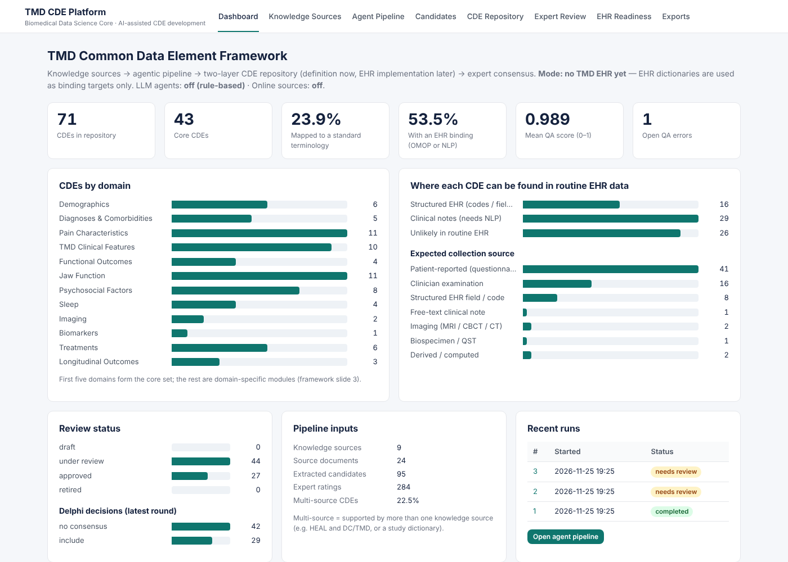
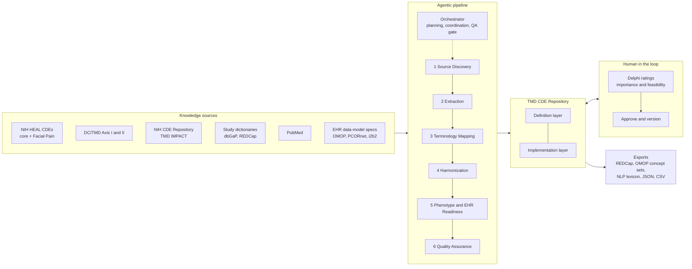
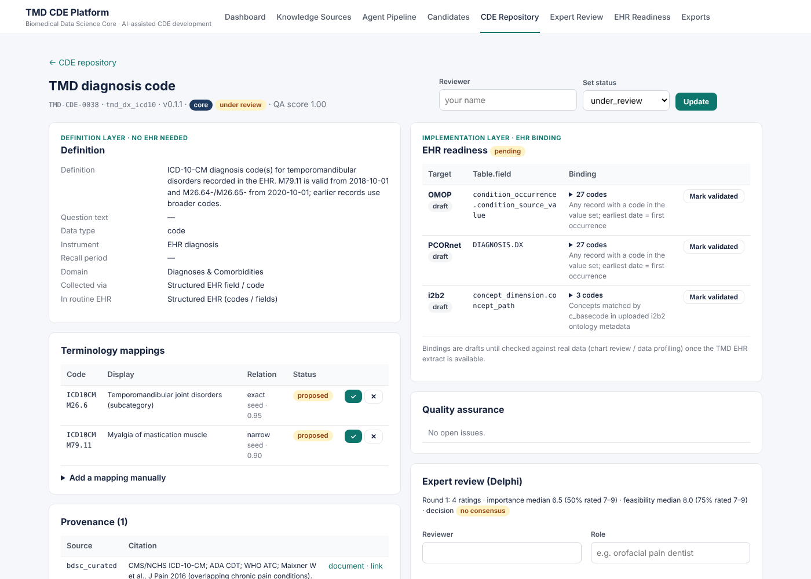
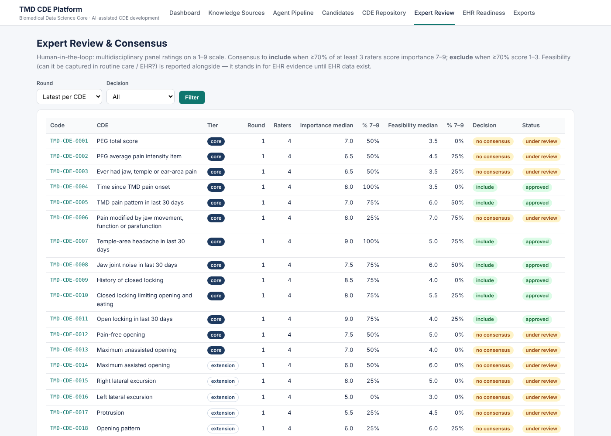
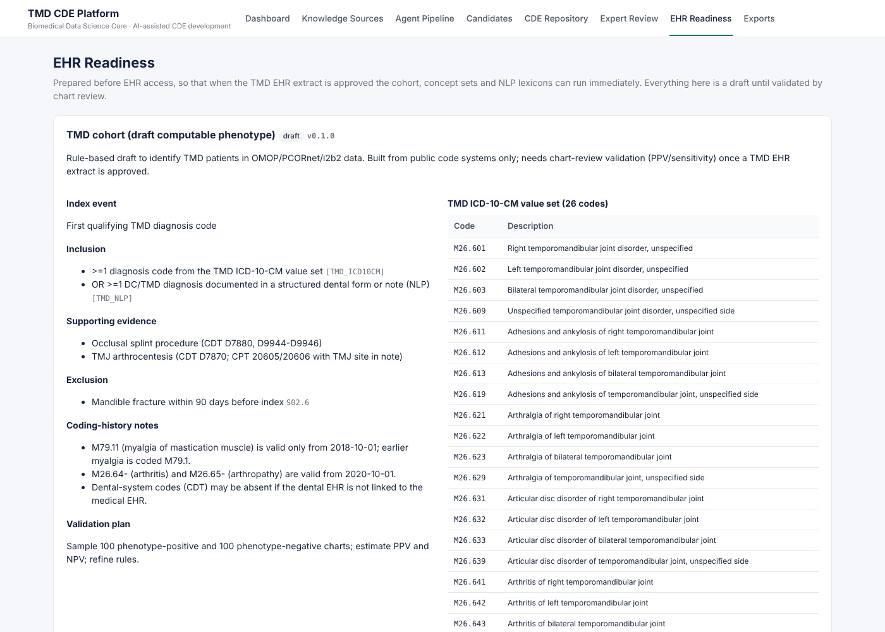
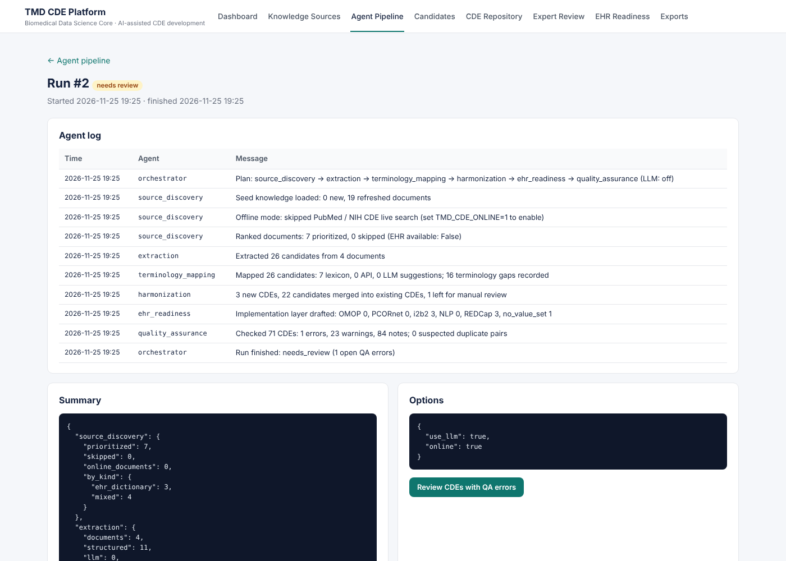

# TMD CDE Platform

**AI-assisted, human-in-the-loop development of Common Data Elements (CDEs) for temporomandibular disorder (TMD) research, designed to work before any TMD EHR data are available.**

[繁體中文說明 (README.zh-TW.md)](README.zh-TW.md)



TMD studies use different questionnaires, examination protocols and variable definitions, and EHR data hold diagnoses and medications but leave most symptom-level detail in free-text notes. This platform builds a TMD-specific CDE framework from existing knowledge sources (NIH HEAL CDEs, DC/TMD, NIH CDE Repository, TMD IMPACT, study data dictionaries, literature) with a multi-agent pipeline. A multidisciplinary panel reviews every element through a Delphi process.

## Why this works without EHR data

A CDE is a **standard definition**, not data. The platform therefore splits each CDE into two layers:

| Layer | Content | Needs EHR? |
|---|---|---|
| **Definition** | name, definition, data type, permissible values, terminology mappings (with explicit *gaps*), provenance, how it is collected, whether routine EHR can capture it | No. It can be reviewed, approved and released now |
| **Implementation** | OMOP / PCORnet / i2b2 bindings with value sets, NLP lexicons for notes, REDCap fields, a draft TMD computable phenotype | Drafted now; each binding is marked *validated* once EHR data arrive |

EHR data-model *specifications* (OMOP CDM, PCORnet CDM, i2b2 ontology metadata) are used as binding targets. No patient data are needed.

## Architecture



| Agent | What it does |
|---|---|
| **Source Discovery** | Loads the source registry, optionally pulls PubMed / NIH CDE Repository, and ranks documents (source weight × TMD relevance). Without EHR data, CDE repositories, instruments and study dictionaries outrank EHR dictionaries. |
| **Extraction** | Parses structured files directly and mines free text with an LLM (Claude) or rules. It also predicts each element's collection source and EHR capturability. |
| **Terminology Mapping** | Proposes ICD-10-CM / LOINC / SNOMED CT / HPO / NCIT codes from a curated lexicon, public APIs and the LLM. Missing codes are recorded as explicit gaps (many TMD instruments have no LOINC code). |
| **Harmonization** | Deduplicates and merges candidates. Guards keep PHQ-2 and PHQ-9, or maximum *unassisted* and *assisted* opening, apart. It also merges provenance and assigns domain, tier and REDCap-safe variable names. |
| **Phenotype & EHR Readiness** | Drafts OMOP / PCORnet / i2b2 / NLP / REDCap bindings and the TMD cohort phenotype, including ICD-10-CM code-history caveats. |
| **Quality Assurance** | Checks completeness, consistency, provenance, terminology gaps, EHR readiness and suspected duplicates. A CDE with open errors cannot be approved. |

The LLM is optional. With no API key the agents run rule-based and offline, and every LLM output is stored as *proposed* for human review.

## Screenshots

| CDE detail (two layers, mappings, Delphi) | Expert review & consensus |
|---|---|
|  |  |
| **EHR readiness (phenotype, value sets, NLP lexicon)** | **Agent run log** |
|  |  |

## Quick start

Requires Python 3.9 or newer.

```bash
python3 -m venv .venv && source .venv/bin/activate      # Windows: .venv\Scripts\activate
pip install -r requirements.txt
python cli.py init          # create the database and load the NIH HEAL / DC-TMD seed sources
python cli.py pipeline      # run all agents once (offline, rule-based by default)
python cli.py serve         # http://127.0.0.1:8000  (JSON API docs at /docs)
```

Optionally, `python cli.py demo-reviews --decide` adds a *synthetic* Delphi round so you can explore the review screens.

Docker: `docker build -t tmd-cde . && docker run -p 8000:8000 tmd-cde`

## Configuration (all optional)

Copy `.env.example` to `.env`.

| Variable | Effect |
|---|---|
| `ANTHROPIC_API_KEY` | Enables LLM extraction from text, LLM code suggestions and drafting of missing definitions |
| `TMD_CDE_ONLINE=1` | PubMed (NCBI E-utilities), NIH CDE Repository search, NLM Clinical Tables (ICD-10-CM, LOINC), EBI OLS (HPO, NCIT) |
| `UMLS_API_KEY` | SNOMED CT lookups via UMLS (free UMLS licence) |
| `TMD_CDE_EHR_AVAILABLE=1` | Raises the priority of EHR dictionaries once a TMD EHR extract exists |
| `TMD_CDE_DB_URL` | Any SQLAlchemy URL (default: SQLite in `data/`) |
| `TMD_CDE_ORG_NAME` | Name shown in the page header |

## Adding knowledge sources

Use the web UI (**Knowledge Sources → Upload**) or the CLI, then re-run the pipeline. Runs are incremental, and human edits are never overwritten.

```bash
python cli.py import heal_cde_file.xlsx   --source nih_heal          # HEAL CDE Repository files
python cli.py import tmd_impact_v3.xlsx   --source tmd_impact
python cli.py import nlm_export.json      --source nlm_cde           # cde.nlm.nih.gov export (JSON/CSV)
python cli.py import data_dict.xml        --source study_dictionary  # dbGaP data dictionary
python cli.py import redcap_dict.csv      --source study_dictionary
python cli.py import i2b2_ontology.csv    --source ehr_cdm           # c_fullname / c_basecode metadata
python cli.py import protocol.txt                                     # protocol or methods text
python cli.py pipeline
```

## Exports

- Full repository with both layers (JSON) and the definition layer as flat CSV
- REDCap data dictionaries (core only, or all modules)
- OMOP source-code concept sets plus SQL to resolve them to standard concepts
- NLP lexicon, the phenotype definition, and an Aim 3-style coverage report

Append `?status=approved` to any CDE export to release only approved elements.

## Static demo (GitHub Pages)

`python scripts/build_static_demo.py --out site` builds a read-only HTML version of the platform. It uses a throw-away database, the seed sources, the synthetic files in `sample_inputs/` and a synthetic Delphi round. Forms are hidden, and tables get a client-side filter.

`.github/workflows/pages.yml` builds and deploys the demo on every push to `main`. To enable it, set **Settings → Pages → Build and deployment → Source** to **GitHub Actions**.

## Development

```bash
pip install -r requirements.txt
pytest -q
```

`.github/workflows/tests.yml` runs the test suite on Python 3.9 and 3.12.

```
app/
  models.py                 two-layer CDE schema (SQLAlchemy)
  seed/nih_tmd_seed.py      NIH HEAL + DC/TMD + EHR-oriented seed elements, ICD-10-CM value set, phenotype, NLP lexicon
  knowledge/                connectors: seed, file importers, PubMed / NLM, terminology APIs, EHR data models
  agents/                   orchestrator and six agents (llm.py = optional Claude wrapper)
  services/                 versioning, Delphi consensus, exports, synthetic demo data
  web/                      FastAPI routes, Jinja2 templates, CSS
cli.py                      init / pipeline / import / serve / demo-reviews
scripts/build_static_demo.py
tests/                      end-to-end tests
sample_inputs/              SYNTHETIC example files for trying the importers
```

## Data sources and attribution

- **NIH HEAL Initiative CDE Program**: core pain CDEs and Facial Pain supplemental CRFs (DC/TMD Symptom Questionnaire, DC/TMD Examination Form, Jaw Functional Limitation Scale). <https://heal.nih.gov/data/common-data-elements>
- **DC/TMD**: Schiffman E, Ohrbach R, et al. *J Oral Facial Pain Headache* 2014;28:6-27, and the DC/TMD Scoring Manual for Self-Report Instruments (INfORM / IADR). <https://inform-iadr.com>
- **NIH CDE Repository** (National Library of Medicine). <https://cde.nlm.nih.gov>
- **ICD-10-CM** (CMS / NCHS, public domain), **WHO ATC** classification.
- This material contains content from **LOINC** (<http://loinc.org>). LOINC is copyright © Regenstrief Institute, Inc. and the Logical Observation Identifiers Names and Codes (LOINC) Committee and is available at no cost under the license at <http://loinc.org/license>.
- **CPT®** is a registered trademark of the American Medical Association, and **CDT** codes are © American Dental Association. Only code numbers are referenced, with neutral labels. Obtain official descriptors from the code owners.

The seed elements are recorded at score / measure level, with definitions written for this project. **Item wording of licensed instruments (BPI, PROMIS, PCS, PHQ/GAD, JFLS, OBC, GCPS) is not included.** Download official CRFs from the HEAL CDE Repository or the instrument owners, and follow their licence terms.

## Disclaimer

This is a research prototype. It is not a medical device and must not be used for clinical decisions. All seed elements, codes and phenotype rules are drafts for expert review. The files in `sample_inputs/` and the demo Delphi ratings are synthetic. The web app has no authentication, so deploy it behind your institution's SSO / reverse proxy.

## License

The code is released under the [MIT License](LICENSE). Third-party instruments, code systems and terminologies keep their own licences.
