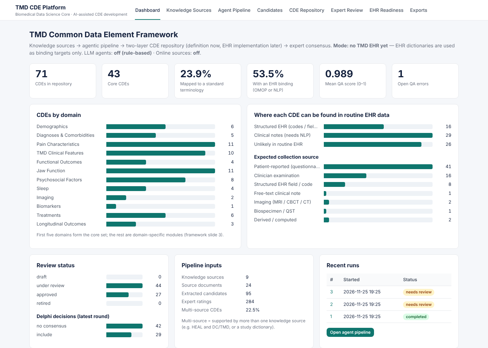

# TMD CDE Platform

**以 AI 輔助、專家把關（human-in-the-loop）的方式，為顳顎關節障礙（TMD）研究建立共通資料元素（CDE）。在還沒有 TMD EHR 資料的階段就能使用。**

[English README](README.md)



各個 TMD 研究使用的問卷、檢查流程和變數定義都不一樣；EHR 裡雖然有診斷和用藥，但症狀層級的資訊大多寫在病歷文字裡。這個平台用多個 agent 組成的流程，從現有知識來源（NIH HEAL CDE、DC/TMD、NIH CDE Repository、TMD IMPACT、研究 data dictionary、文獻）建立 TMD 專屬的 CDE 架構，每一個元素都要經過跨領域專家的 Delphi 審查。

## 為什麼沒有 EHR 也能做

CDE 本質上是**標準定義**，不是資料本身。所以平台把每個 CDE 分成兩層：

| 層 | 內容 | 需要 EHR 嗎？ |
|---|---|---|
| **定義層** | 名稱、定義、資料型態、選項值、標準術語對應（找不到代碼時明確記錄為缺口）、來源出處、收集方式、一般 EHR 能否取得 | 不需要，現在就能審查、核准、發布 |
| **實作層** | OMOP / PCORnet / i2b2 對應與代碼清單、病歷文字的 NLP 詞庫、REDCap 欄位、TMD cohort 判定規則草稿 | 現在先產生草稿，EHR 資料到位後再逐一標記「已驗證」 |

EHR 方面只用公開的資料模型**規格**（OMOP CDM、PCORnet CDM、i2b2 metadata）當作對應目標，不需要任何病人資料。

## 架構

架構圖請見 [English README](README.md#architecture)（GitHub 會自動畫出 Mermaid 圖）。

| Agent | 功能 |
|---|---|
| **Source Discovery** | 建立來源清單，可選擇抓取 PubMed / NIH CDE Repository，並依「來源權重 × TMD 相關性」排序。沒有 EHR 時，CDE repository、量表、研究 dictionary 的優先順序高於 EHR dictionary |
| **Extraction** | 結構化檔案直接解析；文字用 LLM（Claude）或規則抽取；並預測每個元素的收集方式和 EHR 可取得性 |
| **Terminology Mapping** | 從內建詞庫、公開 API 和 LLM 建議 ICD-10-CM / LOINC / SNOMED CT / HPO / NCIT 代碼；找不到時明確記錄為缺口（很多 TMD 量表沒有 LOINC） |
| **Harmonization** | 去除重複並合併候選項，避免 PHQ-2 和 PHQ-9、或「最大自主開口」和「最大輔助開口」被誤合併；合併出處，指定領域、核心／延伸層級和 REDCap 變數名稱 |
| **Phenotype & EHR Readiness** | 產生 OMOP / PCORnet / i2b2 / NLP / REDCap 對應草稿和 TMD cohort 判定規則，包含 ICD-10-CM 改版日期的注意事項 |
| **Quality Assurance** | 檢查完整性、一致性、出處、術語缺口、EHR 準備程度和疑似重複；有未解決錯誤的 CDE 不能核准 |

LLM 是選用的。沒有 API key 時，agents 以規則式、離線方式執行；LLM 產生的所有結果都標成「待確認」，需要人工審查。

## 安裝與執行

需要 Python 3.9 以上。

```bash
python3 -m venv .venv && source .venv/bin/activate      # Windows：.venv\Scripts\activate
pip install -r requirements.txt
python cli.py init          # 建資料庫，載入 NIH HEAL / DC/TMD 的起始資料
python cli.py pipeline      # 跑一次所有 agents（預設離線、規則式）
python cli.py serve         # http://127.0.0.1:8000（JSON API 文件在 /docs）
```

想看審查畫面的效果，可以執行 `python cli.py demo-reviews --decide` 加入一輪**合成的** Delphi 評分。

Docker：`docker build -t tmd-cde . && docker run -p 8000:8000 tmd-cde`

## 設定（全部選用）

把 `.env.example` 複製成 `.env`。

| 變數 | 作用 |
|---|---|
| `ANTHROPIC_API_KEY` | 開啟 LLM：從文字抽取 CDE、建議代碼、補寫缺少的定義 |
| `TMD_CDE_ONLINE=1` | 使用 PubMed、NIH CDE Repository 搜尋、NLM Clinical Tables（ICD-10-CM、LOINC）、EBI OLS（HPO、NCIT） |
| `UMLS_API_KEY` | 透過 UMLS 查 SNOMED CT（需免費的 UMLS 帳號） |
| `TMD_CDE_EHR_AVAILABLE=1` | 拿到 TMD EHR 後開啟，提高 EHR dictionary 的優先順序 |
| `TMD_CDE_DB_URL` | 任何 SQLAlchemy 資料庫網址（預設是 `data/` 裡的 SQLite） |
| `TMD_CDE_ORG_NAME` | 頁首顯示的單位名稱 |

## 加入知識來源

在網站 **Knowledge Sources → Upload** 上傳，或用命令列，然後重跑 pipeline。每次執行只處理新文件，人工修改過的內容不會被覆蓋。

```bash
python cli.py import heal_cde_file.xlsx   --source nih_heal
python cli.py import tmd_impact_v3.xlsx   --source tmd_impact
python cli.py import nlm_export.json      --source nlm_cde
python cli.py import data_dict.xml        --source study_dictionary  # dbGaP data dictionary
python cli.py import redcap_dict.csv      --source study_dictionary
python cli.py import i2b2_ontology.csv    --source ehr_cdm           # c_fullname / c_basecode
python cli.py import protocol.txt
python cli.py pipeline
```

## 匯出

- 包含兩層的完整 CDE 資料庫（JSON），以及定義層的平面 CSV
- REDCap data dictionary（只有核心，或全部模組）
- OMOP 代碼集，加上把它們對應到 standard concept 的 SQL
- NLP 詞庫、cohort 判定規則、Aim 3 覆蓋率報告

在任何 CDE 匯出網址後加 `?status=approved`，就只匯出已核准的元素。

## 線上展示（GitHub Pages）

`python scripts/build_static_demo.py --out site` 會產生一個唯讀的 HTML 版本。它用暫時的資料庫、起始資料、`sample_inputs/` 裡的合成檔案和一輪合成的 Delphi 評分建出來；表單會隱藏，表格可以在瀏覽器裡篩選。

`.github/workflows/pages.yml` 會在每次 push 到 `main` 時自動建置並發布。第一次使用前，請到 **Settings → Pages → Build and deployment → Source** 選擇 **GitHub Actions**。

## 開發

```bash
pip install -r requirements.txt
pytest -q
```

`.github/workflows/tests.yml` 會在 Python 3.9 和 3.12 上自動跑測試。

## 資料來源與標示

請見 [English README](README.md#data-sources-and-attribution)，內有 NIH HEAL、DC/TMD、NIH CDE Repository、ICD-10-CM、WHO ATC、LOINC、CPT/CDT 的來源與授權聲明。

起始資料只記錄到分數／測量層級，定義由本專案撰寫。**有授權的量表（BPI、PROMIS、PCS、PHQ/GAD、JFLS、OBC、GCPS）沒有收錄題目原文**。需要逐題 CDE 時，請從 HEAL CDE Repository 或量表擁有者下載官方檔案，並遵守其授權條款。

## 免責聲明

這是研究用的原型，不是醫療器材，不能用於臨床決策。所有起始元素、代碼和判定規則都是供專家審查的草稿。`sample_inputs/` 裡的檔案和展示用的 Delphi 評分都是合成資料。網站本身沒有登入機制，正式部署請放在機構 SSO 或 reverse proxy 後面。

## 授權

程式碼採用 [MIT License](LICENSE)。第三方量表、代碼系統和術語仍適用其各自的授權。
